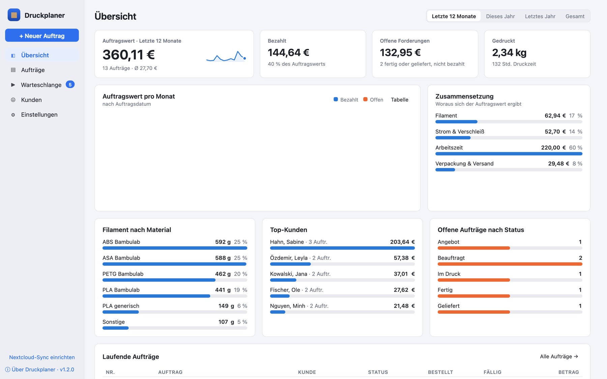
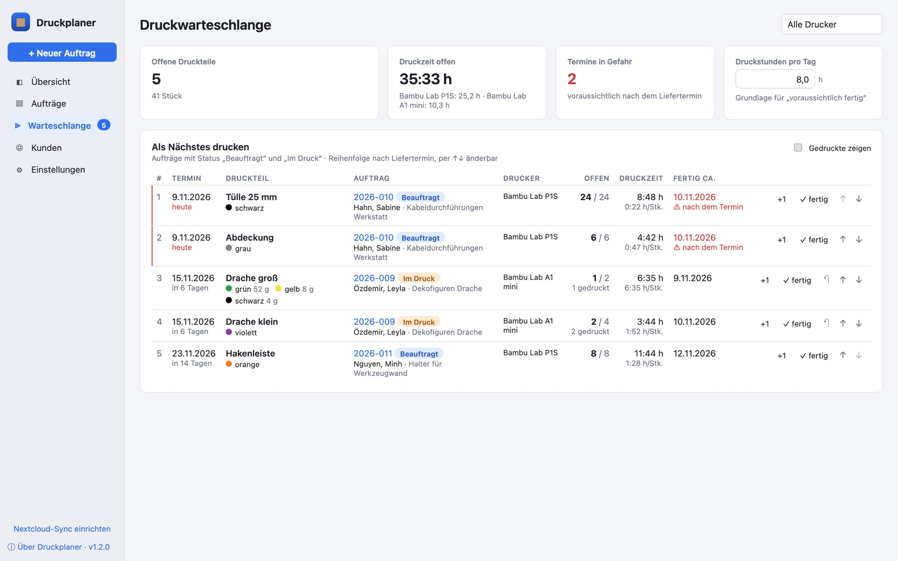
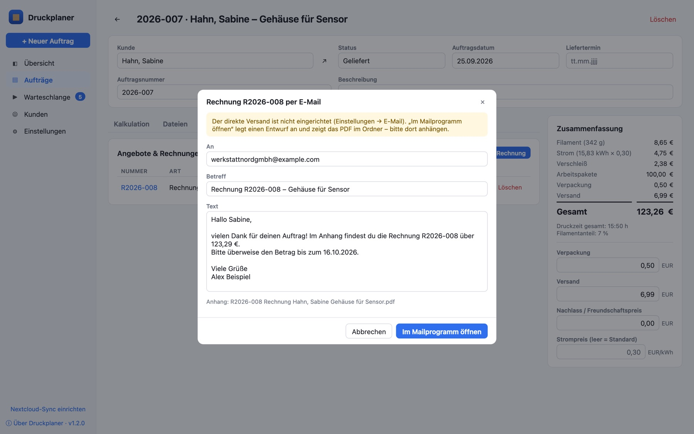
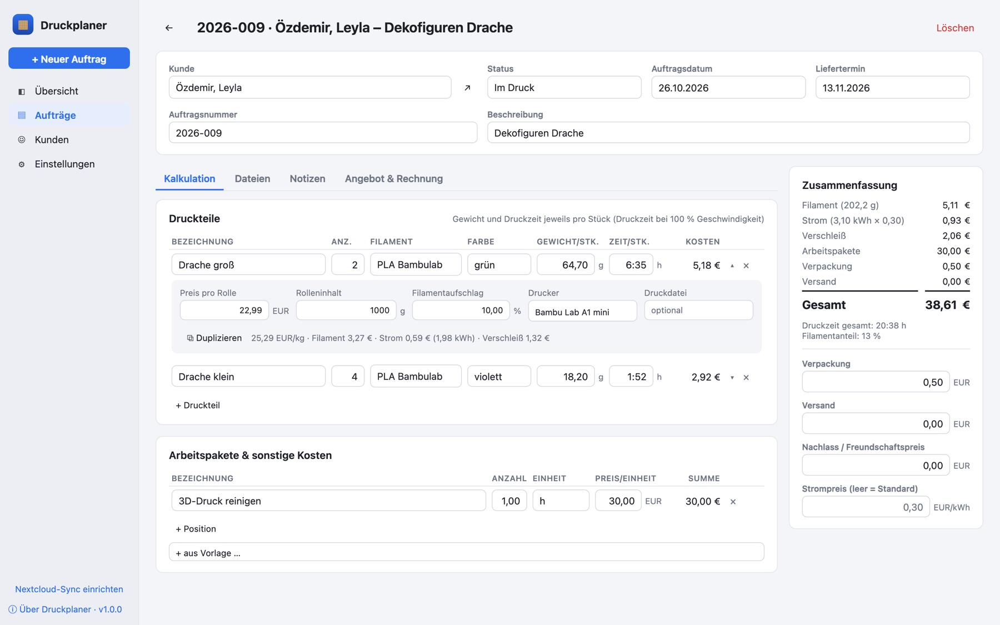
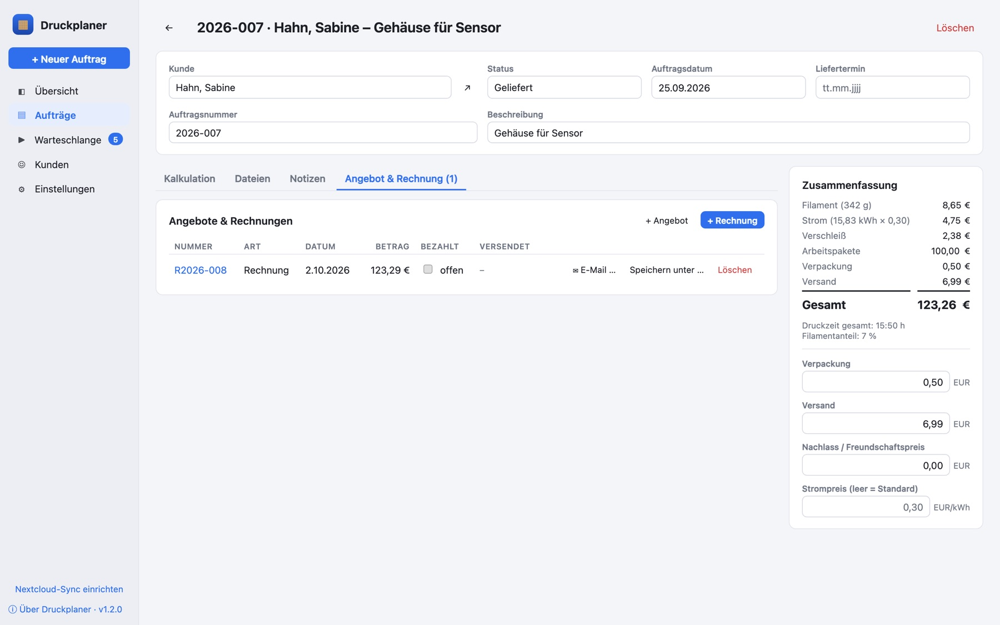
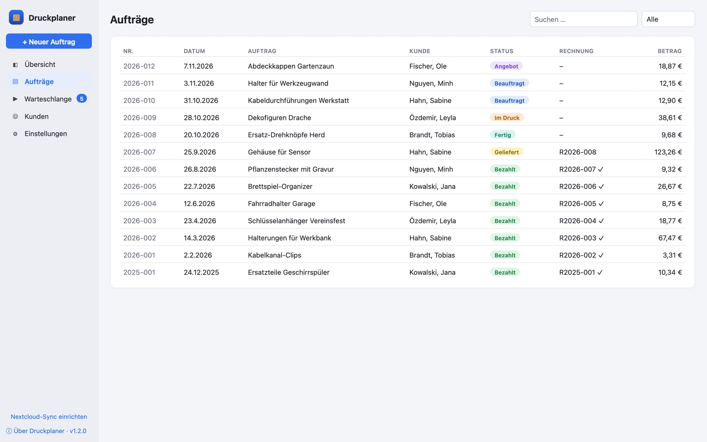
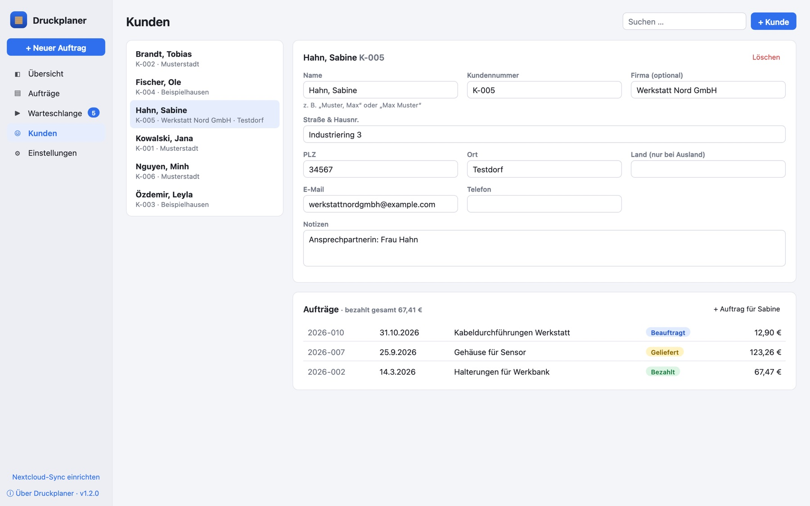
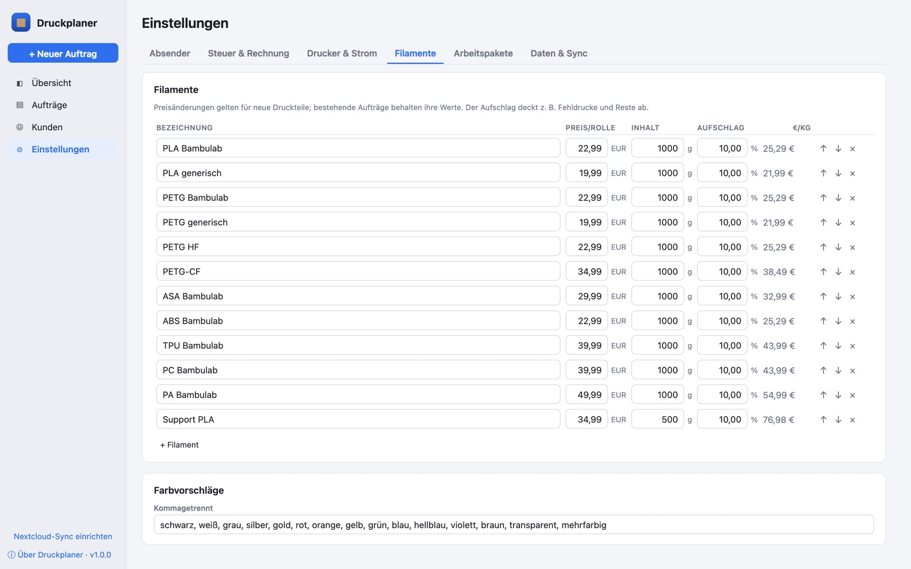
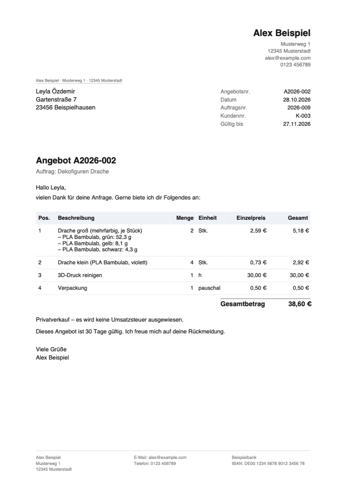

<p align="center">
  
</p>

<h1 align="center">Druckplaner</h1>

<p align="center">
  Projekt- und Kostenplanung für 3D-Druckaufträge: Kalkulation, Kunden, Druckdateien, Druckwarteschlange,<br>
  Angebote und Rechnungen – auf Wunsch direkt per E-Mail.<br>
  Für macOS, Windows und Linux, mit Abgleich über Nextcloud bzw. WebDAV.
</p>

<p align="center">
  <a href="LICENSE"></a>
  <a href="#entstanden-mit-ki"></a>
</p>

<p align="center">
  
</p>

<p align="center"><sub>Beispieldaten mit erfundenen Namen (Demo-Modus, siehe <a href="#entwicklung">Entwicklung</a>)</sub></p>

---

## Inhalt

- [Worum geht es?](#worum-geht-es)
- [Funktionen](#funktionen)
- [Screenshots](#screenshots)
- [Installation](#installation)
- [Erste Schritte](#erste-schritte)
- [So rechnet der Druckplaner](#so-rechnet-der-druckplaner)
- [Angebote und Rechnungen per E-Mail](#angebote-und-rechnungen-per-e-mail)
- [Gemeinsam nutzen mit Nextcloud](#gemeinsam-nutzen-mit-nextcloud)
- [Wo liegen die Daten?](#wo-liegen-die-daten)
- [Entwicklung](#entwicklung)
- [Projektstruktur](#projektstruktur)
- [Bauen und Veröffentlichen](#bauen-und-veröffentlichen)
- [Sicherheit](#sicherheit)
- [Hinweise zur Nutzung](#hinweise-zur-nutzung)
- [Bekannte Einschränkungen](#bekannte-einschränkungen)
- [Entstanden mit KI](#entstanden-mit-ki)
- [Lizenz und Quellen](#lizenz-und-quellen)

## Worum geht es?

Wer einen 3D-Drucker hat, bekommt schnell Anfragen aus dem Freundeskreis: „Kannst du mir das drucken?“ Meist geht
es um kleine Beträge, und genau deshalb wird oft geschätzt statt gerechnet. Der Druckplaner ersetzt die
Kalkulationstabelle, mit der das bisher lief:

- **Fair rechnen:** Filament, Strom, Verschleiß, Arbeitszeit, Verpackung und Versand je Auftrag – nachvollziehbar
  und mit denselben Formeln wie in der Tabelle.
- **Nichts verlieren:** Kunden, Druckdateien, Notizen, Angebote und Rechnungen liegen an einem Ort.
- **Den Überblick behalten:** Was ist offen, was ist bezahlt, wie viel Filament ging dieses Jahr durch den Drucker?
- **Auf mehreren Rechnern:** Die Daten gleichen sich über die eigene Nextcloud ab, ohne Cloud-Dienst Dritter.

Der Druckplaner ist für Privatleute und Kleingewerbe gedacht, nicht als Buchhaltungs- oder Warenwirtschaftssystem.

## Funktionen

### Aufträge

- Auftragsnummer je Jahr (`2026-001`, `2026-002` …), automatisch vergeben und änderbar
- Status von *Anfrage* über *Angebot*, *Beauftragt*, *Im Druck*, *Fertig* und *Geliefert* bis *Bezahlt*
  (oder *Storniert*)
- Auftragsdatum, Liefertermin, Beschreibung und Notizen
- **Bezeichnung automatisch** aus Nummer, Kunde und Beschreibung, z. B.
  `2026-009 · Özdemir, Leyla – Dekofiguren Drache`. Wer eine eigene Bezeichnung möchte, überschreibt sie einfach
  und kann jederzeit zur automatischen zurückkehren.
- Suche über Nummer, Beschreibung, Kunde und Notizen; Filter nach Status

### Kalkulation

- **Druckteile** mit Anzahl, Druckzeit pro Stück, Drucker und einem oder mehreren Filamenten
- **Mehrfarbige Drucke** (z. B. mit dem AMS von Bambu Lab): Mit **＋** bekommt ein Druckteil bzw. eine Druckplatte
  weitere Filamente, jedes mit eigenem Material, eigener Farbe und eigenem Verbrauch in Gramm. Die Druckzeit gilt
  für das ganze Teil.
- Rollenpreis, Rolleninhalt und Filamentaufschlag je Filament. Die Werte werden beim Auswählen des Filaments
  übernommen, **spätere Preisänderungen verändern alte Aufträge nicht**.
- **Strom** aus der Leistung des Druckers und der Druckzeit, Strompreis global oder je Auftrag
- **Verschleiß** pro Druckstunde (optional, je Drucker)
- **Arbeitspakete** frei oder aus Vorlagen (z. B. Konstruktion, Nacharbeiten, Reinigen)
- Verpackung, Versand und Nachlass („Freundschaftspreis“)
- Umsatzsteuer, wenn eingestellt
- Zusammenfassung mit Gesamtpreis, Druckzeit und Filamentanteil, laufend aktualisiert

### Druckdateien und 3MF

- Dateien per **Drag & Drop** oder Dateidialog zum Auftrag hinzufügen (3MF, STL, STEP, SCAD, Bilder, PDF …)
- Öffnen mit dem Standardprogramm, im Finder/Explorer zeigen, umbenennen, löschen
- Bei **Bambu-Studio- und OrcaSlicer-3MF-Dateien** zeigt der Druckplaner das Vorschaubild an. Wurde die Datei nach
  dem Slicen gespeichert, liest er **Druckzeit und Verbrauch je Platte** aus und übernimmt sie auf Knopfdruck als
  Druckteile. Bei mehrfarbigen Platten wird **jedes Filament mit Typ, Farbe und Gewicht** einzeln übernommen.

### Angebote und Rechnungen

- **PDF auf Knopfdruck** mit Absender, Anschrift im Fensterbereich (DIN 5008), Rechnungs-, Auftrags- und
  Kundennummer, Positionen, Summe und Zahlungshinweis
- Fortlaufende Nummern: Rechnungen `R2026-001`, Angebote `A2026-001` (Präfix einstellbar)
- Positionen einzeln (Druckteile, Arbeit, Verpackung, Versand) oder als eine Pauschale
- Bei **mehrfarbigen Druckteilen** stehen unter der Position alle Filamente mit Farbe und Verbrauch pro Stück,
  z. B. „Drache groß (mehrfarbig, je Stück) – PLA, grün: 52,3 g – PLA, gelb: 8,1 g …“
- Steuerhinweis wählbar: **Privatverkauf**, **Kleinunternehmer (§ 19 UStG)** oder **mit Umsatzsteuer**
- Rechnungen als bezahlt markieren; das Datum fließt in die Übersicht ein
- Texte für Einleitung, Grußformel und Hinweise in den Einstellungen anpassbar
- **Per E-Mail an den Kunden:** direkt aus der App über SMTP mit dem PDF im Anhang oder als Entwurf im eigenen
  Mailprogramm. Betreff und Text kommen aus Vorlagen, Versanddatum und Empfänger werden vermerkt (siehe
  [Angebote und Rechnungen per E-Mail](#angebote-und-rechnungen-per-e-mail)).

### Druckwarteschlange

- Zeigt, **was als Nächstes gedruckt werden muss**: jedes offene Druckteil aus Aufträgen mit Status „Beauftragt“ oder
  „Im Druck“, mit Liefertermin, Filamentfarben, Drucker, offenen Stück und offener Druckzeit.
- **Reihenfolge nach Liefertermin**, mit ↑↓ von Hand änderbar. Neue Teile ordnen sich nach ihrem Termin ein, „Nach
  Termin sortieren“ verwirft die eigene Reihenfolge.
- **Zeitplan je Drucker:** Mehrere Drucker laufen parallel. Aus den *Druckstunden pro Tag* berechnet der Druckplaner,
  wann jedes Teil voraussichtlich fertig ist, und **warnt, wenn ein Liefertermin nicht zu halten ist**.
- **Abhaken:** „+1“ für ein gedrucktes Stück, „✓ fertig“ für alle, ↶ zum Zurücknehmen. Mit dem ersten Stück springt
  der Auftrag auf „Im Druck“, wenn alles gedruckt ist auf „Fertig“.
- Filter nach Drucker; die Zahl offener Teile steht in der Seitenleiste.

### Kunden

- Kundennummer (`K-001` …), Name, Firma, Anschrift, E-Mail, Telefon und Notizen
- Liste aller Aufträge des Kunden mit Status und Betrag, Summe der bezahlten Aufträge
- Neuer Auftrag direkt aus der Kundenansicht

### Übersicht

- Kennzahlen: Auftragswert, bezahlt, offene Forderungen, gedrucktes Filament und Druckzeit
- **Auftragswert pro Monat**, getrennt nach bezahlt und offen, auch als Tabelle
- Zusammensetzung der Preise, Filament nach Material, Top-Kunden, offene Aufträge nach Status
- Zeitraum wählbar: letzte 12 Monate, dieses Jahr, letztes Jahr, gesamt

### Und außerdem

- **Nextcloud-Sync** per WebDAV, beim Start, auf Knopfdruck oder in festen Abständen
- Einstellungen für Absender, Steuer, Drucker, Strompreis, Filamente, Farben und Arbeitspakete
- Hell- und Dunkelmodus nach Systemeinstellung
- Alles auf Deutsch, Zahlen mit Komma, Druckzeiten als `1:35`, `1h 35m` oder `95m`

## Screenshots

| Druckwarteschlange | Rechnung per E-Mail |
| --- | --- |
|  |  |
| **Auftrag mit mehrfarbigem Druckteil** | **Angebote und Rechnungen** |
|  |  |
| **Aufträge** | **Kunden** |
|  |  |
| **Einstellungen: Filamente** | **Angebot als PDF, mit mehrfarbigem Druckteil** |
|  |  |

Personen, Firmen, Adressen, Aufträge und Beträge in den Bildern sind erfunden.

## Installation

### Fertige Pakete

Die Installer stehen unter **[Releases](https://github.com/Soeren3003/druckplaner/releases/latest)**:

| System | Datei |
| --- | --- |
| macOS (Apple Silicon und Intel) | `Druckplaner_x.y.z_universal.dmg` |
| Windows | `Druckplaner_x.y.z_x64-setup.exe` oder `.msi` |
| Linux Mint, Ubuntu, Debian | `Druckplaner_x.y.z_amd64.deb` |
| andere Linux-Systeme | `Druckplaner_x.y.z_amd64.AppImage` |

Die App ist **nicht signiert**. Darum gilt beim ersten Start:

- **macOS:** Rechtsklick auf die App → *Öffnen*. Alternativ, wenn sie heruntergeladen wurde:
  ```bash
  xattr -dr com.apple.quarantine /Applications/Druckplaner.app
  ```
- **Windows:** Im SmartScreen-Hinweis *Weitere Informationen → Trotzdem ausführen* wählen.
- **Linux:** `.deb` doppelklicken und installieren oder `sudo apt install ./Druckplaner_x.y.z_amd64.deb`.
  Für das App-Passwort wird ein Schlüsselbund (GNOME Keyring bzw. KWallet) genutzt.

### Selbst bauen

Siehe [Entwicklung](#entwicklung) und [Bauen und Veröffentlichen](#bauen-und-veröffentlichen).

## Erste Schritte

1. **Einstellungen → Absender:** Name, Anschrift, E-Mail und Bankverbindung eintragen. Sie erscheinen auf Angeboten
   und Rechnungen.
2. **Einstellungen → Steuer & Rechnung:** Privatverkauf, Kleinunternehmer oder mit Umsatzsteuer wählen und die
   Texte anpassen.
3. **Einstellungen → Drucker & Strom:** Strompreis und die eigenen Drucker mit ihrer durchschnittlichen Leistung
   beim Drucken eintragen (z. B. Bambu Lab A1 mini rund 150 W).
4. **Einstellungen → Filamente:** Rollenpreise und gewünschten Aufschlag prüfen.
5. **+ Neuer Auftrag:** Kunde wählen oder anlegen, Beschreibung eintragen, Druckteile mit Gewicht und Druckzeit aus
   dem Slicer erfassen – oder die 3MF-Datei unter *Dateien* ablegen und die Werte übernehmen.
6. Unter **Angebot & Rechnung** das PDF erzeugen und mit **✉ E-Mail …** an den Kunden schicken.
7. Ist der Auftrag beauftragt, Status auf **Beauftragt** setzen. Er erscheint dann in der **Warteschlange**; dort
   gedruckte Stück abhaken.
8. Ist die Rechnung bezahlt, Häkchen setzen – fertig.

Optional: **Einstellungen → E-Mail** für den direkten Versand und **Einstellungen → Daten & Sync** für die
Nextcloud.

## So rechnet der Druckplaner

Für jedes Druckteil gilt (Gewicht und Druckzeit pro Stück):

| Anteil | Formel |
| --- | --- |
| Preis pro Gramm | Rollenpreis × (1 + Aufschlag) ÷ Rolleninhalt, je Filament |
| Filament | Summe über alle Filamente: Preis pro Gramm × Gewicht × Anzahl |
| Strom | Leistung des Druckers (kW) × Druckzeit (h) × Anzahl × Strompreis |
| Verschleiß | Verschleiß pro Stunde × Druckzeit (h) × Anzahl |

Dazu kommen Arbeitspakete (Anzahl × Preis), Verpackung und Versand, abzüglich Nachlass. Bei „mit Umsatzsteuer“
wird der Steuersatz aufgeschlagen.

**Beispiel** (aus dem Screenshot oben): 2 × „Drache groß“, mehrfarbig mit 52,30 g grünem, 8,10 g gelbem und
4,30 g schwarzem PLA (zusammen 64,70 g) und 6:35 h Druckzeit je Stück. Alle drei Rollen kosten 22,99 € je 1000 g bei
10 % Aufschlag. Gedruckt wird auf einem Bambu Lab A1 mini mit 150 W, Strom 0,30 €/kWh, Verschleiß 0,10 €/h:

- Preis pro Gramm: 22,99 € × 1,10 ÷ 1000 g = 0,0253 €
- Filament: grün 2 × 52,30 g = 2,65 €, gelb 2 × 8,10 g = 0,41 €, schwarz 2 × 4,30 g = 0,22 € → **Filament 3,27 €**
- Druckzeit 2 × 6:35 h = 13,17 h → 0,15 kW × 13,17 h = 1,98 kWh → **Strom 0,59 €**
- **Verschleiß** 0,10 €/h × 13,17 h = **1,32 €**
- **Teil gesamt 5,18 €**

Auf der Rechnung werden die Stückpreise auf volle Cent gerundet. Weicht die Summe dadurch um ein paar Cent von der
Kalkulation ab, zeigt der Dialog das vor dem Erzeugen an.

## Angebote und Rechnungen per E-Mail

In jedem Auftrag unter *Angebot & Rechnung* öffnet **✉ E-Mail …** einen Dialog:

- **An** ist die E-Mail-Adresse aus dem Kunden. Fehlt sie, kannst du sie eintragen und direkt beim Kunden speichern.
- **Betreff** und **Text** kommen aus den Vorlagen unter *Einstellungen → E-Mail* und lassen sich vor dem Senden
  anpassen.
- **Senden** verschickt die Mail direkt mit dem PDF im Anhang. Dafür muss der SMTP-Versand eingerichtet sein.
- **Im Mailprogramm öffnen** geht immer, auch ohne Einrichtung: Es legt einen Entwurf im Standard-Mailprogramm an
  und zeigt das PDF im Finder bzw. Explorer. Das PDF ziehst du dann in die Mail, denn Anhänge lassen sich über
  diesen Weg technisch nicht mitgeben.

Danach steht in der Liste, wann und an wen das Dokument verschickt wurde. Ein versendetes Angebot setzt eine
Anfrage auf „Angebot“.

**SMTP einrichten** (*Einstellungen → E-Mail*):

1. Unter *Anbieter-Vorlage* den eigenen Anbieter wählen (IONOS, GMX, WEB.DE, Gmail, Posteo, Strato,
   Outlook.com) oder Server, Verschlüsselung und Port selbst eintragen.
2. Absendername, Absenderadresse und Passwort eintragen; der Benutzername ist meist die Absenderadresse. Gmail
   verlangt ein App-Passwort, bei GMX und WEB.DE muss der Zugriff über E-Mail-Programme erlaubt sein.
3. *Direkten Versand aktivieren*, speichern und *Verbindung testen*.

Optional schickt der Druckplaner eine Blindkopie jeder Mail an dich selbst, als Nachweis im eigenen Postfach. Die
SMTP-Zugangsdaten gelten nur für den jeweiligen Rechner und werden nicht synchronisiert; das Passwort liegt im
Schlüsselbund. Gesendet wird immer verschlüsselt (STARTTLS oder SSL/TLS).

In den Vorlagen stehen diese Platzhalter zur Verfügung: `{vorname}`, `{name}`, `{nummer}`, `{auftrag}`,
`{auftragsnr}`, `{betrag}`, `{faellig}` (Zahlungsziel), `{gueltig}` (Gültigkeit des Angebots) und `{absender}`.

## Gemeinsam nutzen mit Nextcloud

Der Druckplaner kann seinen Datenordner mit einem Ordner in der eigenen Nextcloud (oder einem anderen
WebDAV-Server) abgleichen. So sind Aufträge, Kunden, Dateien und Rechnungen auf mehreren Rechnern gleich.

1. In Nextcloud unter *Einstellungen → Sicherheit* ein **App-Passwort** erstellen (nicht das normale Passwort
   verwenden).
2. Im Druckplaner unter *Einstellungen → Daten & Sync* eintragen:
   - **Server-Adresse:** `https://cloud.example.com` oder die WebDAV-Adresse aus *Nextcloud → Dateien →
     Einstellungen*
   - **Benutzername** und **App-Passwort**
   - **Ordner auf dem Server** (Standard `Druckplaner`, wird angelegt, falls nicht vorhanden)
   - **Automatisch synchronisieren:** nur beim Start, alle 5 oder 15 Minuten oder stündlich
3. *Verbindung testen*, dann *Synchronisation aktivieren* und speichern.
4. Auf weiteren Rechnern genauso einrichten.

So funktioniert der Abgleich:

- Für jede Datei merkt sich der Druckplaner, wie sie beim letzten Abgleich aussah. Daran erkennt er, auf welcher
  Seite sich etwas geändert hat, und überträgt nur das.
- Gelöschte Aufträge und Dateien werden auch auf der anderen Seite gelöscht.
- **Konflikte:** Wurde derselbe Datensatz auf zwei Geräten geändert, gewinnt der neuere Stand. Der andere bleibt im
  Ordner `conflicts/` erhalten.
- Ist eine Seite **komplett leer** (neuer Rechner, neuer Server-Ordner), wird nichts gelöscht, sondern alles
  übernommen.
- Verbindungen laufen nur über **HTTPS**. Das App-Passwort liegt im Schlüsselbund des Systems und wird nie
  synchronisiert.

Der Ordner muss **nicht** im Nextcloud-Client liegen. Liegt der Datenordner trotzdem in einem vom Client
synchronisierten Ordner, sollte der eingebaute Sync ausgeschaltet bleiben.

## Wo liegen die Daten?

Alles liegt als einfache Dateien im Datenordner:

| System | Standardordner |
| --- | --- |
| macOS | `~/Library/Application Support/de.soeren3003.druckplaner/data` |
| Windows | `%APPDATA%\de.soeren3003.druckplaner\data` |
| Linux | `~/.local/share/de.soeren3003.druckplaner/data` |

```
db/customers/<id>.json      Kunden
db/projects/<id>.json       Aufträge (mit Kalkulation und Liste der Angebote/Rechnungen)
db/settings/settings.json   Einstellungen (Absender, Steuer, Drucker, Filamente …)
files/<auftrag-id>/…        Druckdateien und Anhänge
invoices/*.pdf              erzeugte Angebote und Rechnungen
conflicts/                  (nur lokal) ältere Version bei Sync-Konflikten
.sync-state.json            (nur lokal) Stand des letzten Abgleichs
```

Daneben liegt die lokale `config.json` mit Datenordner, Sync- und SMTP-Einstellungen, aber ohne Passwörter. Diese
liegen im Schlüsselbund des Systems (Einträge `de.soeren3003.druckplaner.webdav` und `…smtp`). Der
Datenordner lässt sich in den Einstellungen ändern, *Öffnen* zeigt ihn im Finder bzw. Explorer.

Zum **Sichern** genügt eine Kopie des Datenordners.

## Entwicklung

Voraussetzungen: [Node.js](https://nodejs.org) (22 oder neuer) und [Rust](https://rustup.rs), unter macOS
z. B. `brew install node rust`. Unter Linux zusätzlich die
[Tauri-Abhängigkeiten](https://tauri.app/start/prerequisites/) (WebKitGTK, libdbus).

```bash
npm install
npm run tauri dev      # App mit Hot-Reload starten
npm test               # Tests der Oberfläche (Kalkulation, Nummern, Eingaben)
cd src-tauri && cargo test
```

**Browser-Vorschau und Demo-Modus:** `npm run dev` startet nur die Oberfläche unter `http://localhost:1420`. Die Daten
liegen dann im Speicher des Browsers, Dateien und Sync stehen nicht zur Verfügung.

- `http://localhost:1420/?demo` lädt **erfundene Beispieldaten** (`src/lib/demo.ts`). Damit sind auch die
  Screenshots entstanden.
- Startansicht per URL, z. B. `?project=proj-10&tab=kalkulation`, `?page=customers&id=cust-5` oder
  `?page=settings&tab=filamente`

**Sync-Integrationstest** gegen einen lokalen WebDAV-Server:

```bash
pip install wsgidav cheroot
mkdir -p /tmp/dav/remote.php/dav/files/test
wsgidav --host=127.0.0.1 --port=8765 --root=/tmp/dav --auth=anonymous &
cd src-tauri && DRUCKPLANER_TEST_DAV=http://127.0.0.1:8765 cargo test --test sync_dav
```

Weitere Befehle:

```bash
npm run licenses              # THIRD_PARTY_LICENSES.md und Lizenzliste der App neu erzeugen
npm run set-version -- 1.1.0  # Versionsnummer überall setzen
```

## Projektstruktur

```
src/                          Oberfläche (React + TypeScript)
  App.tsx                     Rahmen, Navigation, Seitenleiste
  pages/                      Übersicht, Aufträge, Auftrag (Kalkulation, Dateien, Dokumente), Kunden, Einstellungen
  components/                 Diagramme, Eingabefelder, Dialoge, „Über Druckplaner“, Lizenzliste
  lib/calc.ts                 Kalkulation und Rechnungspositionen
  lib/numbering.ts            Kunden- und Auftragsnummern, automatische Bezeichnung
  lib/invoice.ts              PDF für Angebote und Rechnungen (jsPDF)
  lib/store.tsx               Daten laden, speichern, synchronisieren
  lib/api.ts                  Brücke zur Desktop-Hülle (im Browser: Ersatz mit localStorage)
  lib/queue.ts                Druckwarteschlange: Reihenfolge, Zeitplan je Drucker, Status beim Abhaken
  lib/mailtext.ts             E-Mail-Vorlagen mit Platzhaltern
  lib/threemf.ts              Druckteile aus 3MF-Daten, Farbnamen
  lib/demo.ts                 erfundene Beispieldaten
src-tauri/                    Desktop-Hülle (Rust, Tauri 2)
  src/lib.rs                  Befehle für die Oberfläche
  src/store.rs                Ablage im Datenordner, Prüfung von Kennungen und Dateinamen
  src/sync.rs                 Zwei-Wege-Abgleich mit Konfliktbehandlung
  src/webdav.rs               WebDAV-Client
  src/mail.rs                 E-Mail-Versand über SMTP (lettre) und mailto-Links
  src/threemf.rs              Vorschaubild, Gewicht und Druckzeit aus 3MF-Dateien
  src/config.rs               lokale Einstellungen und Schlüsselbund
  src/migrate.rs              Übernahme der Daten nach einer Änderung der App-Kennung
  tests/sync_dav.rs           Sync-Integrationstest
scripts/                      Lizenzliste, Versionsnummer
docs/screenshots/             Bilder für diese README
```

## Bauen und Veröffentlichen

### Lokal (macOS)

```bash
npm run tauri build
```

Die App liegt danach unter `src-tauri/target/release/bundle/macos/Druckplaner.app`, das Installationsabbild unter
`src-tauri/target/release/bundle/dmg/`. Zum Installieren die App nach *Programme* ziehen.

### Über GitHub Actions

Der Workflow `.github/workflows/build.yml` führt die Tests aus und baut alle drei Plattformen:

- **Release:** Ein Versions-Tag erzeugt automatisch ein GitHub-Release. Die Notizen stammen aus dem CHANGELOG,
  die Installer für macOS, Windows und Linux werden angehängt. Das Release wird erst sichtbar, wenn alle
  Builds fertig sind.
  ```bash
  git tag -a v1.0.0 -m "Version 1.0.0"
  git push <remote> v1.0.0
  ```
  Das Tag muss zur Versionsnummer in `package.json` passen, sonst bricht der Workflow ab.
- **Nur bauen:** manuell unter *Actions → Build → Run workflow*. Die Installer hängen dann als Artefakte am Lauf.

### Versionen

Die Versionsnummern folgen der [semantischen Versionierung](https://semver.org/lang/de/) (`MAJOR.MINOR.PATCH`).
Was sich in welcher Version geändert hat, steht im [CHANGELOG.md](CHANGELOG.md).

So entsteht eine neue Version:

```bash
npm run set-version -- 1.1.0     # setzt die Nummer in package.json, Cargo.toml, tauri.conf.json und den Lockfiles
# CHANGELOG.md ergänzen, dann:
git commit -am "Version 1.1.0"
git tag -a v1.1.0 -m "Version 1.1.0"
```

## Sicherheit

Das Sicherheitskonzept und der Weg zum Melden von Lücken stehen in **[SECURITY.md](SECURITY.md)**. Kurz gesagt:

- **Zugangsdaten nur lokal:** Es gibt keine Zugangsdaten im Repository. Das Nextcloud-App-Passwort und das
  SMTP-Passwort liegen im Schlüsselbund.
- **E-Mail nur verschlüsselt,** genau ein geprüfter Empfänger pro Mail, keine eingeschleusten Kopfzeilen, Anhänge nur
  aus dem eigenen Rechnungsordner.
- **Abgeschottete Oberfläche:** Eine strikte Content-Security-Policy gilt, und fremde Daten werden nie als HTML
  eingesetzt.
- **Geprüfte Befehle:** Was die Oberfläche anstoßen kann, ist eng begrenzt (Dateinamen, Dateitypen, Links).
  Programme und Skripte werden nicht direkt geöffnet, Sync-Pfade können den Datenordner nicht verlassen.
- **3MF-Dateien** werden nur gelesen, nie entpackt, und nur bis zu einer Höchstgröße.
- **Abhängigkeiten ohne bekannte Lücken** (`npm audit`, `cargo audit`):

```bash
npm audit
cargo install cargo-audit && (cd src-tauri && cargo audit)
```

Die Warnungen von `cargo audit` zu „unmaintained“ bzw. „unsound“ (z. B. `zvariant`, `glib`, `proc-macro-error`)
betreffen nur den Linux-Unterbau von Tauri (GTK, D-Bus). Sie sind keine bekannten Sicherheitslücken und werden mit
Tauri-Updates behoben.

## Hinweise zur Nutzung

- Die Kalkulation ist eine Hilfe für faire Preise, **keine Buchhaltung**. Einnahmen bitte zusätzlich so
  aufbewahren, wie es für dich vorgeschrieben ist.
- Die Rechnungsvorlagen ersetzen **keine steuerliche Beratung**. Ob du privat verkaufen darfst, Kleinunternehmer bist
  oder Umsatzsteuer ausweisen musst, hängt von deiner Situation ab.
- Kundendaten sind **personenbezogene Daten**. Speichere nur, was du für den Auftrag brauchst, und synchronisiere nur
  mit einem Server, dem du vertraust.
- Wer Druckvorlagen aus dem Internet verwendet, sollte deren Lizenz beachten: Manche Modelle dürfen nicht
  kommerziell gedruckt werden.

## Bekannte Einschränkungen

- Die App ist nicht signiert (siehe [Installation](#installation)).
- Es gibt keine **E-Rechnung** (XRechnung/ZUGFeRD), nur PDF.
- Werden auf zwei Geräten gleichzeitig Aufträge angelegt, kann eine Nummer doppelt vergeben werden. Die App
  markiert das, die Nummer lässt sich ändern.
- Gewicht und Druckzeit lassen sich nur aus 3MF-Dateien von Bambu Studio und OrcaSlicer lesen, und nur, wenn die
  Datei nach dem Slicen gespeichert wurde. Aus STL-Dateien werden keine Werte gelesen.
- Ein eigenes Logo auf Rechnungen ist noch nicht möglich.
- E-Mails gehen an genau einen Empfänger. Weitere Empfänger lassen sich über *Im Mailprogramm öffnen* ergänzen.
- Manche Anbieter, etwa Microsoft bei Outlook.com, erlauben die SMTP-Anmeldung per Passwort nicht mehr. Dann bleibt
  der Weg über das Mailprogramm.
- Die Druckwarteschlange plant jeden Drucker als eine Maschine, die nacheinander druckt. Pausen, Plattenwechsel und
  Fehldrucke stecken nur pauschal in den *Druckstunden pro Tag*.
- Bei mehrfarbigen Drucken wird der Abfall beim Farbwechsel (Purge, Prime Tower) nicht gesondert erfasst. Er steckt
  im Verbrauch, den der Slicer je Filament angibt, oder lässt sich über den Filamentaufschlag berücksichtigen.
- Beim Sync sollten alle Geräte dieselbe Version nutzen. Ab Version 1.1 speichert der Druckplaner mehrere Filamente
  je Druckteil, ältere Versionen zeigen diese Aufträge nicht richtig an.

## Entstanden mit KI

Der Druckplaner ist in **Zusammenarbeit mit der KI [Claude](https://claude.ai) von Anthropic** entstanden.
Genutzt wurde dafür [Claude Code](https://claude.com/claude-code).

Die Aufgaben waren so verteilt:

- **Mensch (Soeren3003):**
  - Idee und Anforderungen aus der Praxis, mit der eigenen Kalkulationstabelle für 3D-Druckaufträge als Vorlage
  - Entscheidungen über Funktionen, Aufbau, Nummernformate, Lizenz und Veröffentlichung
  - Prüfen und Ausprobieren der Ergebnisse
- **KI (Claude):**
  - Entwurf der Architektur
  - der Großteil des Quellcodes, der Tests und dieser Dokumentation
  - Vorschläge für zusätzliche Funktionen (z. B. 3MF-Auswertung, Übersicht mit Diagrammen, Verschleißkosten)

Commits, an denen die KI mitgearbeitet hat, sind in der Versionsgeschichte mit `Co-Authored-By: Claude …`
gekennzeichnet.

Der Code ist mit automatischen Tests abgesichert und wurde während der Entwicklung in der App ausprobiert. Wie bei
jeder Software können trotzdem Fehler enthalten sein. Hinweise und Verbesserungen sind ausdrücklich willkommen.

## Lizenz und Quellen

Der Druckplaner ist freie Software unter der **[MIT-Lizenz](LICENSE)**. Jeder darf ihn nutzen, verändern und
weitergeben, auch kommerziell, solange der Copyright- und Lizenzhinweis erhalten bleibt. Die Software wird ohne
Gewährleistung bereitgestellt.

### Verwendete Komponenten

Die App enthält rund 500 Komponenten anderer Autorinnen und Autoren: npm-Pakete für die Oberfläche und Rust-Crates
für die Desktop-Hülle. Alle stehen unter freien Lizenzen, die mit der MIT-Lizenz vereinbar sind:

- MIT, Apache-2.0, BSD, ISC, Zlib und Unicode-3.0
- MPL-2.0 nur für wenige, unveränderte Tauri-Abhängigkeiten
- LGPL nur als Wahloption

Bei Wahlmöglichkeit wird MIT genutzt. Alle Lizenztexte stehen in **[THIRD_PARTY_LICENSES.md](THIRD_PARTY_LICENSES.md)**
und in der App unter *Über Druckplaner → Lizenzen aller Komponenten*.

Die wichtigsten Komponenten:

| Komponente | Zweck | Lizenz |
| --- | --- | --- |
| [Tauri](https://tauri.app/) | Desktop-Hülle für macOS, Windows und Linux | MIT / Apache-2.0 |
| [React](https://react.dev/) | Oberfläche | MIT |
| [jsPDF](https://github.com/parallax/jsPDF) und [AutoTable](https://github.com/simonbengtsson/jsPDF-AutoTable) | Angebote und Rechnungen als PDF | MIT |
| [reqwest](https://github.com/seanmonstar/reqwest) mit [rustls](https://github.com/rustls/rustls) | verschlüsselte WebDAV-Verbindung | MIT / Apache-2.0 |
| [quick-xml](https://github.com/tafia/quick-xml) | WebDAV-Antworten, 3MF-Metadaten | MIT |
| [zip](https://github.com/zip-rs/zip2) | Lesen von 3MF-Dateien | MIT |
| [lettre](https://github.com/lettre/lettre) | E-Mail-Versand über SMTP | MIT |
| [keyring](https://github.com/hwchen/keyring-rs) | Passwörter im Schlüsselbund | MIT / Apache-2.0 |
